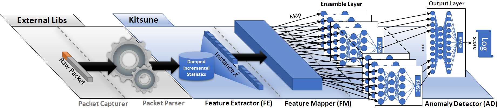

# Kitsune NDSS 2018 Reproduction

This repository documents a course reproduction of Kitsune, an online and
unsupervised network intrusion detection system based on an ensemble of
autoencoders.

The implementation is adapted from the authors' public
[Kitsune-py](https://github.com/ymirsky/Kitsune-py) code under the MIT License.
The original paper is:

> Yisroel Mirsky, Tomer Doitshman, Yuval Elovici, and Asaf Shabtai.
> *Kitsune: An Ensemble of Autoencoders for Online Network Intrusion Detection.*
> NDSS 2018.



## Reproduction scope

- Build the 100-dimensional AfterImage feature vector from network packets.
- Split correlated features with the incremental feature mapper.
- Train the KitNET autoencoder ensemble online without labels.
- Evaluate the main Mirai experiment on the public 764,137-packet dataset.
- Sweep `maxAE` over 1, 5, 10, and 20 to examine the speed/accuracy trade-off.

## Results

The main run uses `maxAE=10`, `FM_grace=5000`, and `AD_grace=50000`.

| Metric | Result |
|---|---:|
| ROC AUC | 0.9042 |
| TPR at FPR = 0 | 0.8159 |
| TPR at FPR = 0.001 | 0.8160 |
| Clean-traffic median RMSE | 0.0096 |
| Attack-traffic median RMSE | 17.9590 |
| Processing rate | 1,032 packets/s |

Parameter sweep:

| maxAE | Feature groups | Packets/s | AUC |
|---:|---:|---:|---:|
| 1 | 100 | 598 | 0.9119 |
| 5 | 31 | 885 | 0.9022 |
| 10 | 16 | 1,032 | 0.9042 |
| 20 | 12 | 1,013 | 0.9089 |

The full numerical summaries are in `results/*_metrics.txt` and
`results/maxae_summary.txt`. Figures are in `results/*.png`.

## Repository layout

| Path | Purpose |
|---|---|
| `Kitsune.py` | Main online training and detection loop |
| `AfterImage.py` | Damped incremental statistics |
| `netStat.py` | Network-channel grouping |
| `FeatureExtractor.py` | Feature extraction wrapper |
| `KitNET/` | Feature mapping and autoencoder ensemble |
| `quickrun.py` | Small quick-start runner |
| `study/` | Reproduction and analysis scripts |
| `results/` | Metrics and figures from completed runs |
| `original_code_backup/` | Upstream files before compatibility edits |

## Environment

Validated with Python 3.13.9 on macOS:

```bash
python3 -m venv .venv
source .venv/bin/activate
python -m pip install -r requirements.txt
```

## Data

The Mirai capture is not included because it is a large external dataset.
Download the dataset from the authors' repository, extract it, and place
`mirai.pcap` in the repository root:

<https://github.com/ymirsky/Kitsune-py>

## Run the reproduction

Main experiment:

```bash
python study/step3_full_run.py --pcap mirai.pcap --max-minutes 25
```

Outputs:

- `results/full_rmse.csv`
- `results/full_rmse.png`
- `results/full_metrics.txt`

Parameter sweep:

```bash
python study/step3_full_run.py --max-ae 1  --out-prefix ae1
python study/step3_full_run.py --max-ae 5  --out-prefix ae5
python study/step3_full_run.py --max-ae 10 --out-prefix ae10
python study/step3_full_run.py --max-ae 20 --out-prefix ae20
python study/step5_maxae_summary.py
```

Small feature-inspection demo:

```bash
python study/step1_features.py
python quickrun.py --pcap study/demo6.pcap --limit 6 --fm-grace 2 --ad-grace 2
```

## Implementation notes

The public Python implementation differs from the paper in three places:

1. It extracts 100 features rather than the paper's 115 because the standalone
   source-IP channel is commented out.
2. The third 1D statistic is named `std` but returns variance.
3. The HH and HpHp channel aggregation scopes differ from the paper's description.

These differences and the evaluation limitations are discussed in the local
course report. Scores are based on time-based labels because per-packet ground
truth is unavailable for the public capture.

Compatibility edits for current NumPy versions were limited to replacing
`np.Inf`/`numpy.Inf` and making the tshark path portable. See
`original_code_backup/` for the pre-edit files.

## License

The upstream code and this reproduction are distributed under the MIT License.
See [LICENSE](LICENSE) and [KitNET/LICENSE.txt](KitNET/LICENSE.txt).
